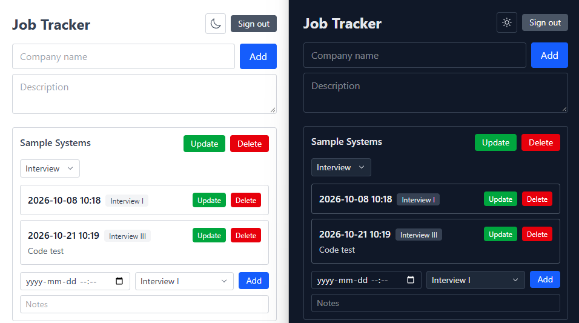

# Job Tracker

A small job application tracker, built over a weekend as an experiment in AI-assisted development.

**Live demo:** https://job-tracker-henna-mu-33.vercel.app/



## What it does

A tracker for job seekers to keep a record of their applications and everything that happens with each company.

- Sign up and sign in with email and password
- Add, edit and delete a company, with a description and a status (Applied / Interview / Rejected)
- Add, edit and delete activities for each company (interviews, calls and mails), with a date, a type and notes
- Each user can only see and edit their own data: Row Level Security in the database checks that every row belongs to the logged-in user
- Light and dark mode, with a toggle that remembers your choice
- If saving or deleting an activity fails, the error is shown in red inside that activity's row. It clears on the next save or delete, or when you press Cancel

## Tech stack

- React + TypeScript (Vite)
- Tailwind CSS
- Supabase (PostgreSQL, Auth, Row Level Security, Edge Functions)
- Vitest (unit tests)
- Vercel (hosting)
- GitHub

## How I worked

I used AI to generate code and to explain errors, and made the design decisions myself:

- Split the UI into components under `src/components/` and moved the shared type into `src/types/`
- Extracted data fetching into a custom hook, `useApplications`
- Changed the status dropdown to use an explicit Save button instead of saving on every change
- Added a confirmation before deleting
- Replaced the generated "allow everyone" Row Level Security policy with one that limits each row to its owner (`user_id`)

## Known limitations

- Errors from adding an activity or loading the list appear below the list instead of in a row, and stay until the next add.
- No password reset.
- The code still uses "interview" in file and table names, while the screen says "Activity".

## Run locally

1. Create a Supabase project.

2. In the SQL Editor, run the files in the `sql/` folder one by one, in this order:
   1. `000_applications.sql`
   2. `001_interviews.sql`
   3. `002_interviews_rls.sql`
   4. `003_rename_notes_to_description.sql`
   5. `004_add_interview_type.sql`

3. Create a file named `.env.local` in the project root and add your project's URL and anon key (Supabase dashboard → Project Settings → API):

```
   VITE_SUPABASE_URL=your-project-url
   VITE_SUPABASE_ANON_KEY=your-anon-key
```

4. Install and start:

```
   npm install
   npm run dev
```

## Run tests

```
npm test
```

Tests use Vitest and run once (`vitest run`). Test files are named `*.test.ts` and sit next to the code they test, for example `src/utils/toLocalInput.test.ts`.

The date tests fix the time zone to `Europe/Stockholm` (see `vitest.global-setup.ts`), so they give the same result on any machine.